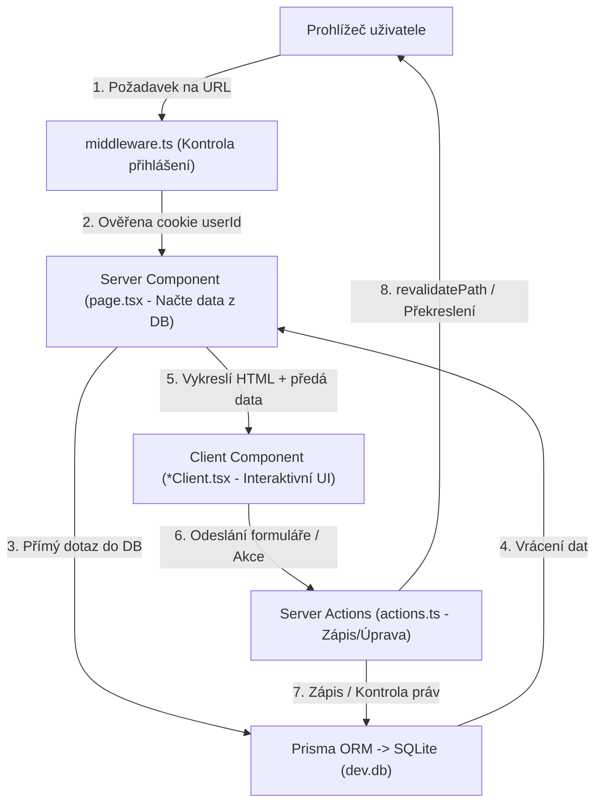
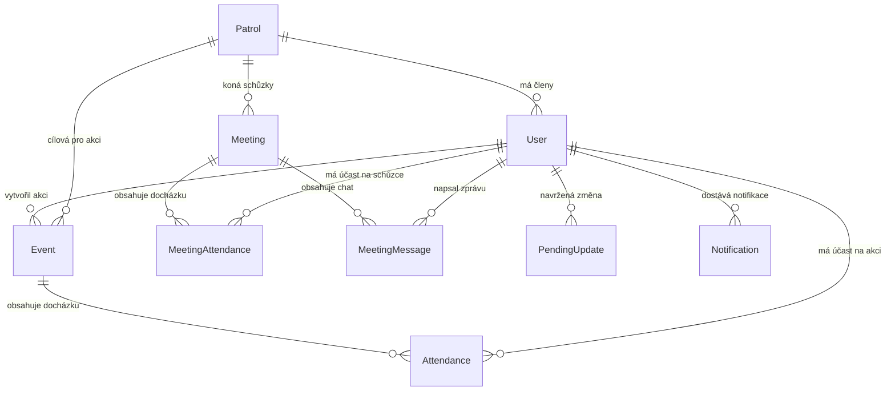

# ⚜️ SKAUTAPP – Kompletní průvodce a architektura aplikace

Tento dokument slouží jako **komplexní a srozumitelný přehled celé vaší aplikace**. Najdete zde detailně popsané, na jakých technologiích aplikace běží, jak je strukturovaná, jak funguje databáze, jak jsou řešena práva uživatelů a jak přesně pracují jednotlivé moduly.

---

## 📌 Obsah
1. [O čem aplikace je](#1-o-čem-aplikace-je)
2. [Na čem aplikace běží (Tech Stack)](#2-na-čem-aplikace-běží-tech-stack)
3. [Architektura a princip fungování](#3-architektura-a-princip-fungování)
4. [Uživatelské role a oprávnění](#4-uživatelské-role-a-oprávnění)
5. [Datový model a databáze (Prisma & SQLite)](#5-datový-model-a-databáze-prisma--sqlite)
6. [Detailní rozbor všech modulů a stránek](#6-detailní-rozbor-všech-modulů-a-stránek)
7. [Zabezpečení a přihlašování](#7-zabezpečení-a-přihlašování)
8. [Struktura složek v projektu](#8-struktura-složek-v-projektu)
9. [Jak aplikaci spustit a spravovat](#9-jak-aplikaci-spustit-a-spravovat)
10. [Jak aplikaci dále rozšiřovat (Kuchařka)](#10-jak-aplikaci-dále-rozšiřovat-kuchařka)

---

## 1. O čem aplikace je

**SKAUTAPP** je moderní interní informační systém (IS) vytvořený na míru skautským oddílům. Jeho cílem je nahradit nepřehledné tabulky v Excelu, papírové přihlášky a chaotickou komunikaci v e-mailech či chatech.

### Hlavní přínosy:
- **Pro vedoucí:** Rychlý přehled o docházce na schůzky i vícedenní výpravy, generování schůzek na celé pololetí, bezpečná kartotéka členů s kontakty na rodiče, alergiemi a zdravotními poznámkami, správa oddílových dokumentů.
- **Pro rádce a družiny:** Vlastní prostor pro družinu, evidence členů družiny, termíny a místa schůzek.
- **Pro členy a rodiče:** Přehled nadcházejících akcí, možnost snadného přihlašování/odhlašování (RSVP), kalendář, přístup k důležitým formulářům a chat k jednotlivým schůzkám.

---

## 2. Na čem aplikace běží (Tech Stack)

Aplikace je postavená na nejmodernějším webovém ekosystému současnosti:

| Oblast | Technologie | K čemu v aplikaci slouží |
| :--- | :--- | :--- |
| **Framework** | **Next.js 16** (App Router) | Páteř celé aplikace. Zajišťuje serverový rendering (SSR), směrování (routing) a Server Actions (backend logiku). |
| **Jazyk** | **TypeScript 5** | Zajišťuje typovou bezpečnost, eliminuje chyby ještě před spuštěním a napovídá v editoru. |
| **UI Knihovna** | **React 19** | Reaktivní komponenty, správa stavu uživatelského rozhraní. |
| **Styling** | **Tailwind CSS v4** | Moderní utility-first CSS framework pro rychlý, responzivní a čistý design. |
| **Databáze** | **SQLite** (`dev.db`) | Souborová relační databáze přímo v projektu. Rychlá, bez nutnosti instalovat externí SQL server. |
| **ORM** | **Prisma 5.22** | Objektově-relační mapování pro bezpečnou komunikaci s databází v TypeScriptu bez psaní surového SQL. |
| **Grafy** | **Recharts** | Vykreslování interaktivních sloupcových grafů v docházkovém systému. |
| **Ikony** | **Lucide React** | Vektorové ikony v celém rozhraní (stany, kompasy, zvonečky, uživatelé atd.). |
| **E2E Testy** | **Playwright** | Automatizované testování uživatelských scénářů přímo v prohlížeči. |

---

## 3. Architektura a princip fungování

Aplikace využívá moderní architekturu **Next.js App Router**:



### Klíčové principy:
1. **Server Components (Výchozí):** Všechny soubory `page.tsx` běží na serveru. Mají přímý přístup k databázi přes Prismu, nezatěžují prohlížeč zbytečným JavaScriptem a předpřipraví hotové HTML.
2. **Client Components (`"use client"`):** Komponenty s příponou `*Client.tsx` (např. `AttendanceClient.tsx`, `MembersClient.tsx`) běží v prohlížeči. Starají se o interaktivitu – vyhledávání v reálném čase, otevírání modálních oken, animace a grafy.
3. **Server Actions (`"use server"`):** Namísto vytváření složitých REST API (`/api/neco`) se data odesílají přímo přes Next.js Server Actions (soubory `actions.ts`). Ty přijímají data, zkontrolují oprávnění volajícího a po zápisu zavolají `revalidatePath()`, čímž se okamžitě aktualizuje pohled v prohlížeči.
4. **Middleware (`middleware.ts`):** Každý příchozí požadavek zkontroluje přítomnost cookie `userId`. Nepřihlášený uživatel je okamžitě přesměrován na `/login`. Pokud se přihlášený pokusí jít na `/login`, je poslán na `/`.

---

## 4. Uživatelské role a oprávnění

V aplikaci se role kontrolují na úrovni backendových akcí i v bočním menu.

### Role v systému:
- **`admin` (Hlavní administrátor):**
  - Plný přístup ke všemu.
  - Výhradní přístup do sekce **Administrace** (`/admin`).
  - Může vytvářet, upravovat a mazat uživatelské účty, přiřazovat role a vynucovat reset hesla.
  - Schvaluje návrhy na změnu údajů členů.
- **`user` / `leader` / `LEADER` (Vedoucí / Rádce):**
  - Správa výprav a akcí (vytváření, editace, mazání, prohlížení účastníků).
  - Generování a úprava schůzek na celé pololetí.
  - Přístup do **Docházky** (analytické grafy a kompletní tabulka).
  - Přístup do **Členů** (kartotéka, zdravotní údaje, kontakty na rodiče, schvalování změn).
  - Správa družin (nastavení místa a času).
  - Správa dokumentů včetně kategorie *Pro vedoucí*.
- **`MEMBER` / `child` / `parent` (Člen / Dítě / Rodič):**
  - Přehled výprav: vidí celooddílové akce a akce své družiny.
  - Přihlašování / odhlašování na akce (RSVP: ANO / NE / MOŽNÁ + poznámka).
  - Schůzky: vidí pouze schůzky své vlastní družiny, může hlásit účast a psát do chatu schůzky.
  - Kalendář: chronologický přehled.
  - Dokumenty: veřejné dokumenty a přihlášky (dokumenty pro vedoucí nevidí).
  - Můj profil: možnost změny svého hesla a jména; úprava údajů (adresa, rodiče) se odešle jako návrh ke schválení vedoucímu.

### Matice oprávnění v přehledu:

| Funkce / Stránka | Člen / Dítě | Vedoucí / Leader | Administrátor |
| :--- | :---: | :---: | :---: |
| **Přehled (Dashboard)** | ✅ (svá družina) | ✅ (vše) | ✅ (vše) |
| **Hlášení své účasti (RSVP)** | ✅ | ✅ | ✅ |
| **Vytváření / editace akcí** | ❌ | ✅ | ✅ |
| **Kompletní matice docházky** | ❌ | ✅ | ✅ |
| **Generování sérií schůzek** | ❌ | ✅ | ✅ |
| **Zobrazení zdravotních údajů** | ❌ | ✅ | ✅ |
| **Schvalování změn údajů** | ❌ | ✅ | ✅ |
| **Dokumenty pro vedoucí** | ❌ | ✅ | ✅ |
| **Správa uživatelů & hesel** | ❌ | ❌ | ✅ |

---

## 5. Datový model a databáze (Prisma & SQLite)

Databáze je uložena v souboru `skaut-app/prisma/dev.db`. Schéma je definováno v `skaut-app/prisma/schema.prisma`.



### Popis jednotlivých tabulek (Modelů):

1. **`User` (Uživatel / Člen):**
   - Přihlašovací údaje: `email` (unikátní), `password` (SHA-256 hash), `name`, `role` (`admin`, `LEADER`, `MEMBER` apod.).
   - Stav účtu: `mustChangePassword` (příznak pro nucenou změnu hesla při 1. přihlášení).
   - Osobní údaje: `birthDate`, `healthNote` (zdravotní stav), `dietaryRestrictions` (alergie/diety), `address`, `city`, `postalCode`.
   - Kontakty na rodinu: `parentPhone`, `motherName`, `motherPhone`, `fatherName`, `fatherPhone`, `otherGuardianName`, `otherGuardianPhone`.
   - Vazby: přiřazení k družině (`patrolId`), rodinné vztahy (`parents`, `children`, `siblings`).

2. **`Patrol` (Družina):**
   - `name` (např. *Lišáci*, *Vlčata*).
   - `schedule` (pravidelný čas, např. *"Středa 16:30 - 18:00"*).
   - `location` (např. *"Klubovna 1. patro"*).

3. **`Event` (Výprava / Akce):**
   - Informace o akci: `title`, `description`, `location`, `date` (začátek), `dateEnd` (konec).
   - Logistika: `meetingPoint` (místo srazu), `returnPoint` (místo návratu), `accommodation`, `food`, `equipment`.
   - Kapacita a termíny: `targetPatrol` (určeno pro konkrétní družinu nebo *"Všichni"*), `capacity`, `rsvpDeadline` (uzávěrka přihlášek).
   - Finance: `priceChildren`, `priceOlder`, `paymentDeadline`, `paymentMethod`.
   - Kontakty: `leaderInCharge` (vedoucí akce), `leaderContact`.

4. **`Attendance` (Docházka na výpravy):**
   - Propojuje `userId` a `eventId`.
   - `status`: `"ANO"`, `"NE"`, `"MOZNA"`, `"PENDING"`.
   - `note`: volitelná poznámka (např. *"Přijedu až v sobotu ráno"*).

5. **`Meeting` (Schůzka družiny):**
   - `title`, `date`, `endTime`, `location`, `comment`, `patrolId`.

6. **`MeetingAttendance` (Docházka na schůzky):**
   - Propojuje `userId` a `meetingId`.
   - `status`, `note`.

7. **`MeetingMessage` (Zprávy v chatu schůzky):**
   - `text`, `createdAt`, vazba na autora (`userId`) a danou schůzku (`meetingId`).

8. **`PendingUpdate` (Čekající návrhy na změnu údajů):**
   - Uchovává změny, které člen/rodič zadal ve svém profilu.
   - Uloženo jako serializovaný JSON v poli `data`. Čeká na schválení vedoucím.

9. **`Notification` (Upozornění / Zvoneček):**
   - `userId`, `title`, `message`, `isRead` (přečteno), `link` (kam proklik vede).

10. **`Document` (Dokumenty ke stažení):**
    - `name`, `url` (odkaz nebo soubor), `category` (např. *"Pro vedoucí"*, *"Tábor"*, *"Přihlášky"*), `type` (`"pdf"` nebo `"link"`).

---

## 6. Detailní rozbor všech modulů a stránek

### 🏠 Přehled (Dashboard – `/`)
- **Účel:** Vstupní rozcestník po přihlášení.
- **Logika:** Automaticky zjistí družinu přihlášeného uživatele.
  - Zobrazuje **nejbližší nadcházející výpravu** určenou pro jeho družinu nebo celooddílovou.
  - Zobrazuje **nejbližší schůzku** jeho družiny.
  - Obsahuje rychlé prokliky do detailů.

### 🏕️ Výpravy a akce (`/expedition`)
- **Komponenty:** `page.tsx`, `EventsClient.tsx`, `EditEventModal.tsx`, `EventCard.tsx`.
- **Filtrování:** Běžný člen vidí pouze své akce. Vedoucí vidí všechny akce oddílu.
- **Přihlašování (RSVP):** Člen má u každé akce rychlá tlačítka (Ano / Ne / Možná) a pole na poznámku.
- **Správa pro vedoucí:**
  - Tlačítko pro vytvoření nové akce se všemi detaily (ceny, sraz, vybavení, kontakt).
  - Při vytvoření akce se automaticky rozešle notifikace všem uživatelům do zvonečku.
  - Možnost editovat existující akci v modálu a mazat ji.
  - Zobrazení přehledného seznamu přihlášených dětí včetně jejich poznámek.

### 🧭 Schůzky (`/meetings`)
- **Komponenty:** `page.tsx`, `MeetingsClient.tsx`, `MeetingCard.tsx`, `AddMeetingForm.tsx`.
- **Generátor schůzek:** Vedoucí nemusí zadávat schůzky po jedné. Modál *"Generovat schůzky"* vytvoří týdenní opakování na zvolené období a umožňuje zadat data prázdnin (např. podzimní prázdniny), která se automaticky přeskočí.
- **Docházka na schůzku:** Rychlé nahlášení účasti členem.
- **Chat ke schůzce:** Každá schůzka má integrované diskusní vlákno, kde mohou rádci i členové komunikovat (např. co vzít s sebou).

### 📊 Docházka (`/attendance`)
- **Přístup:** Pouze pro vedoucí a administrátory.
- **Komponenty:** `AttendanceClient.tsx`.
- **Vizualizace (Recharts):**
  - Interaktivní sloupcový graf zobrazující poměr účastníků (ANO / NE / MOŽNÁ) v průběhu času.
- **Kompletní maticový přehled:**
  - Tabulka se všemi dětmi v řádcích a všemi aktivitami (výpravy + schůzky) ve sloupcích.
  - Možnost přepínat filtry: *Vše*, *Pouze výpravy*, *Pouze schůzky*.
  - Barevné ikony (Zelená = účastnil se, Červená = neúčastnil se, Žlutá = možná, Šedá pomlčka = nevyjádřil se).

### 📅 Kalendář (`/calendar`)
- **Komponenty:** `page.tsx`.
- **Účel:** Sjednocená časová osa. Spojí budoucí schůzky i víkendové výpravy do jednoho chronologického seznamu s přehlednou datumovkou, ikonou typu aktivity a místem konání.

### 🛡️ Družiny (`/patrols`)
- **Komponenty:** `page.tsx`, `PatrolsClient.tsx`.
- **Účel:** Přehled všech družin v oddíle.
- **Funkce:**
  - Zobrazuje seznam dětí přiřazených k dané družině.
  - Vedoucí mohou přímo upravovat pravidelný čas konání schůzek a místo (klubovnu).

### 👥 Členové (`/members`)
- **Přístup:** Pouze pro vedoucí a administrátory.
- **Komponenty:** `MembersClient.tsx`, `actions.ts`.
- **Funkce:**
  - **Filtry a vyhledávání:** Okamžité fulltextové vyhledávání (ignoruje diakritiku), filtrace podle družiny a věkových kategorií (<10 let, 11–15 let, >15 let).
  - **Karta člena:** Detailní zobrazení kontaktů na matku, otce či zástupce, zdravotní omezení a alergeny/diety.
  - **Vytvoření nového člena:** Přidání dítěte s automatickým vygenerováním účtu (výchozí heslo `skaut123` s nutností změny při prvním přihlášení).
  - **Schvalování úprav (`PendingUpdate`):** Pokud si člen nebo rodič upraví údaje, vedoucím se nahoře zobrazí výrazný oranžový box *"Čeká na vaše schválení"* s možností jedním klikem schválit nebo zamítnout změnu.

### 📁 Dokumenty (`/documents`)
- **Komponenty:** `DocumentsClient.tsx`.
- **Kategorie:** Přihlášky, Tábor, Oddílové řády, *Pro vedoucí*.
- **Oprávnění:** Běžní členové nevidí dokumenty v kategorii *Pro vedoucí*.
- **Správa:** Vedoucí mohou nahrávat nové odkazy/PDF a mazat zastaralé.

### ⚙️ Administrace (`/admin`)
- **Přístup:** Pouze role `admin`.
- **Komponenty:** `AdminContent.tsx`.
- **Možnosti:**
  - Přehled všech registrovaných uživatelů v systému.
  - Založení nového uživatele s libovolnou rolí a přiřazením k družině.
  - Editace údajů (změna jména, e-mailu, role, družiny).
  - Vynucení resetu hesla (uživatel je při příštím přihlášení vyzván ke změně).
  - Smazání uživatelského účtu.

### 🔔 Záhlaví, notifikace a globální vyhledávání (`Header.tsx`)
- **Globální vyhledávání (`Ctrl+K` / `Cmd+K`):**
  - Debounce 300 ms (nevyčerpává systém při psaní).
  - Automaticky odstraňuje diakritiku (vyhledá *"Tomáš"* i při zadání *"tomas"*).
  - Prohledává členy, akce, schůzky i dokumenty najednou a respektuje práva uživatele.
- **Zvoneček (Notifikace):**
  - Zobrazuje počet nepřečtených zpráv.
  - Po rozkliknutí nabízí označení zprávy jako přečtené a přímý proklik na danou akci.

---

## 7. Zabezpečení a přihlašování

1. **Hashování hesel:** Hesla nejsou uložena v čistém textu, ale jsou hashována algoritmem **SHA-256** pomocí nativního modulu `crypto`.
2. **Přihlašovací identifikátor:** Uživatel se může přihlásit jak svým **e-mailem**, tak svým **jménem/přezdívkou** (odstraněny bílé znaky).
3. **Session Cookies:** Po přihlášení server nastaví `userId` do cookie s atributy:
   - `httpOnly: true` (skript v prohlížeči ji nemůže přečíst, ochrana proti XSS).
   - `sameSite: "lax"` (ochrana proti CSRF).
   - `path: "/"` a platnost 7 dní.
4. **Povinná změna hesla (`mustChangePassword`):**
   - Pokud admin vytvoří nového člena nebo resetuje heslo, uživatel má nastaveno `mustChangePassword: true`.
   - Middleware a RootLayout ho okamžitě přesměrují na stránku `/change-password`. Dokud si nezvolí bezpečné heslo (min. 4 znaky), nepustí ho do systému.

---

## 8. Struktura složek v projektu

```text
skaut-app/
├── app/                        # Next.js App Router (stránky a serverová logika)
│   ├── actions.ts              # Hlavní Server Actions (login, akce, vyhledávání...)
│   ├── layout.tsx              # Kořenový layout (načítá uživatele, notifikace, menu)
│   ├── globals.css             # Globální styly Tailwind CSS
│   ├── page.tsx                # Hlavní přehled (Dashboard)
│   ├── login/                  # Přihlašovací stránka
│   ├── change-password/        # Změna hesla při 1. přihlášení
│   ├── expedition/             # Výpravy a akce (+ EditEventModal, EventsClient)
│   ├── meetings/               # Schůzky družin (+ MeetingsClient, akce)
│   ├── attendance/             # Analytika docházky (+ AttendanceClient s grafy)
│   ├── calendar/               # Kalendář akcí a schůzek
│   ├── patrols/                # Družiny (+ PatrolsClient)
│   ├── members/                # Kartotéka členů (+ MembersClient, schvalování)
│   ├── documents/              # Knihovna dokumentů (+ DocumentsClient)
│   ├── admin/                  # Administrátorská sekce (+ AdminContent)
│   └── profile/                # Můj profil (změna hesla, osobních údajů)
├── components/                 # Znovupoužitelné komponenty
│   ├── ClientAppShell.tsx      # Responzivní obal aplikace, mobilní vysouvací menu
│   ├── Header.tsx              # Horní lišta s vyhledávačem a zvonečkem
│   ├── Sidebar.tsx             # Boční navigační panel s rolemi
│   ├── EventCard.tsx           # Karta výpravy
│   ├── MeetingCard.tsx         # Karta schůzky
│   └── FloatingField.tsx       # Formulářový input s plovoucím popiskem
├── prisma/                     # Databáze a schémata
│   ├── schema.prisma           # Definice všech tabulek a vztahů
│   ├── dev.db                  # Samotná SQLite databáze
│   ├── migrations/             # Historie migrací databáze
│   ├── seed.ts                 # Výchozí testovací data
│   └── seed-members.ts         # Generátor realistických skautských členů
├── public/                     # Statické soubory (obrázky, favicon)
├── middleware.ts               # Ochrana rout a ověření přihlášení
├── package.json                # Seznam závislostí a skriptů
└── tsconfig.json               # Konfigurace TypeScriptu
```

---

## 9. Jak aplikaci spustit a spravovat

Všechny příkazy se spouštějí v terminálu uvnitř složky `skaut-app`:

### 1. Instalace knihoven:
```bash
cd skaut-app
npm install
```

### 2. Příprava databáze a migrací:
```bash
npx prisma migrate dev
```

### 3. Naplnění databáze vzorovými daty (Seed):
```bash
npx prisma db seed
```

### 4. Spuštění vývojového serveru:
```bash
npm run dev
```
Aplikace běží na: [http://localhost:3000](http://localhost:3000)

### 5. Výchozí administrátorský účet:
- **E-mail:** `vedouci@skaut.cz`
- **Heslo:** `tajneheslo`

### 6. Další užitečné příkazy:
- `npx prisma studio` – otevře vizuální webový prohlížeč celé databáze v prohlížeči na portu 5555. Skvělé pro rychlou kontrolu dat!
- `npm run build` – otestuje a sestaví ostrou produkční verzi.
- `npm run lint` – zkontroluje správnost zápisu kódu.

---

## 10. Jak aplikaci dále rozšiřovat (Kuchařka)

### A. Chci přidat nové pole do databáze (např. velikost trička člena):
1. Otevřete `prisma/schema.prisma`.
2. Do modelu `model User` přidejte řádek:
   ```prisma
   tshirtSize String?
   ```
3. V terminálu spusťte:
   ```bash
   npx prisma migrate dev --name add_tshirt_size
   ```
4. Prisma automaticky zaktualizuje TypeScript typy i SQLite databázi. Nyní můžete pole používat v `MembersClient.tsx` i v `actions.ts`.

### B. Chci přidat novou stránku do aplikace:
1. Vytvořte novou složku v `app/`, např. `app/sklad/`.
2. Uvnitř vytvořte soubor `page.tsx` s exportem výchozí React komponenty:
   ```tsx
   export default async function SkladPage() {
     return <div className="p-8"><h1>Sklad vybavení</h1></div>;
   }
   ```
3. Otevřete `components/Sidebar.tsx` a přidejte novou položku do pole `nav`:
   ```tsx
   { href: "/sklad", label: "Sklad", icon: Package },
   ```

---

> [!TIP]
> Kdykoliv budete chtít zkontrolovat stav databáze nebo ručně upravit data, spusťte v terminálu příkaz `npx prisma studio`. Otevře se vám přehledná tabulka v prohlížeči.
